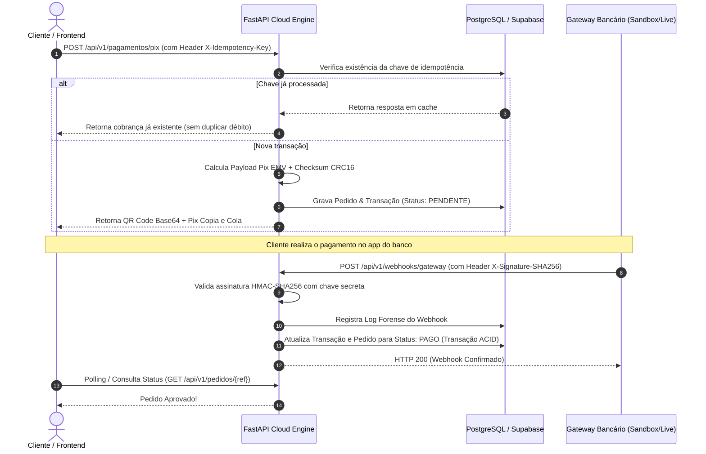

# ⚡ CloudPay Nexus Engine - Gateway de Pagamentos & Webhooks na Nuvem

Microserviço em nuvem de alta confiabilidade desenvolvido em **Python (FastAPI)**, **PostgreSQL / Supabase** e **Docker** para processamento de pagamentos Pix, validação criptográfica de Webhooks e controle de concorrência com **Idempotência**.

---

## 🏗️ Arquitetura do Sistema e Fluxo de Dados



---

## 🎯 Diferenciais Técnicos e Engenharia Aplicada

- **Cálculo de Checksum CRC16 Polinomial**: Geração de códigos Pix seguindo estritamente as especificações do **Banco Central do Brasil** (Padrão EMV BR Code).
- **Segurança contra Replay & Falsificação**: Validação de assinaturas via **HMAC-SHA256** utilizando `hmac.compare_digest` para imunidade contra **Timing Attacks**.
- **Controle Estrito de Idempotência**: Suporte ao header `X-Idempotency-Key` com persistência relacional, garantindo que retentativas de rede não gerem cobranças duplicadas.
- **Transações ACID e Modelagem Relacional**: SQLAlchemy ORM configurado com pool de conexões resiliente (`pool_pre_ping=True`) para bancos de nuvem como **Supabase**, **Neon** e **AWS RDS**.
- **Containerização Pronta para Nuvem**: `Dockerfile` multi-stage com healthcheck nativo e `docker-compose.yml` para orquestração da API e PostgreSQL.
- **Documentação OpenAPI / Swagger**: Interface interativa de testes gerada automaticamente em `/docs`.

---

## 🛠️ Tecnologias e Ferramentas

| Componente | Tecnologia |
| :--- | :--- |
| **Linguagem & Framework** | Python 3.12+, FastAPI, Uvicorn |
| **Validação & Serialização** | Pydantic V2, Pydantic-Settings |
| **Banco de Dados & ORM** | PostgreSQL, SQLite (Dev), SQLAlchemy 2.0 |
| **Container & Nuvem** | Docker, Docker Compose |
| **Segurança** | Criptografia HMAC-SHA256, Hashlib |
| **Geração de QR Code** | QRCode (PIL) em Base64 |
| **Testes Automatizados** | Pytest, FastAPI TestClient, HTTPX |

---

## 🚀 Como Executar o Projeto

### Opção 1: Via Docker Compose (Recomendado - Sobe API + PostgreSQL)
```bash
docker-compose up --build -d
```
A API estará disponível em: `http://localhost:8000/docs`

### Opção 2: Execução Local com Python
```bash
# 1. Crie e ative um ambiente virtual
python -m venv venv
venv\Scripts\activate  # Windows

# 2. Instale as dependências
pip install -r requirements.txt

# 3. Inicie o servidor
uvicorn app.main:app --reload --port 8000
```

### 🧪 Executar Testes Automatizados
```bash
pytest tests/ -v
```

---

## 🌐 Testar o Checkout Visual no Navegador
Basta abrir o arquivo [`frontend/index.html`](./frontend/index.html) diretamente no seu navegador. Ele já possui modo autônomo com suporte para simulação de pagamentos mesmo estático no **GitHub Pages**!

---

## 💼 Pitch para Propostas no Workana / 99freelas

> *"Olá! Para a sua demanda de integração de pagamentos e nuvem, desenvolvo soluções completas com **FastAPI/Python**, **PostgreSQL** e **Docker**. Tenho em meu portfólio o **CloudPay Nexus**, que inclui emissão de Pix no padrão oficial do Banco Central, validação criptográfica de Webhooks com HMAC-SHA256 (para garantir que notificações falsas nunca aprovem pedidos) e controle de idempotência contra duplicidade. O código possui testes automatizados e arquitetura pronta para deploy em qualquer provedor de nuvem. Você pode testar a demonstração e conferir a arquitetura completa no meu GitHub: https://github.com/gattz2020/portifolio/tree/main/projects/04-cloud-payment-gateway"*
